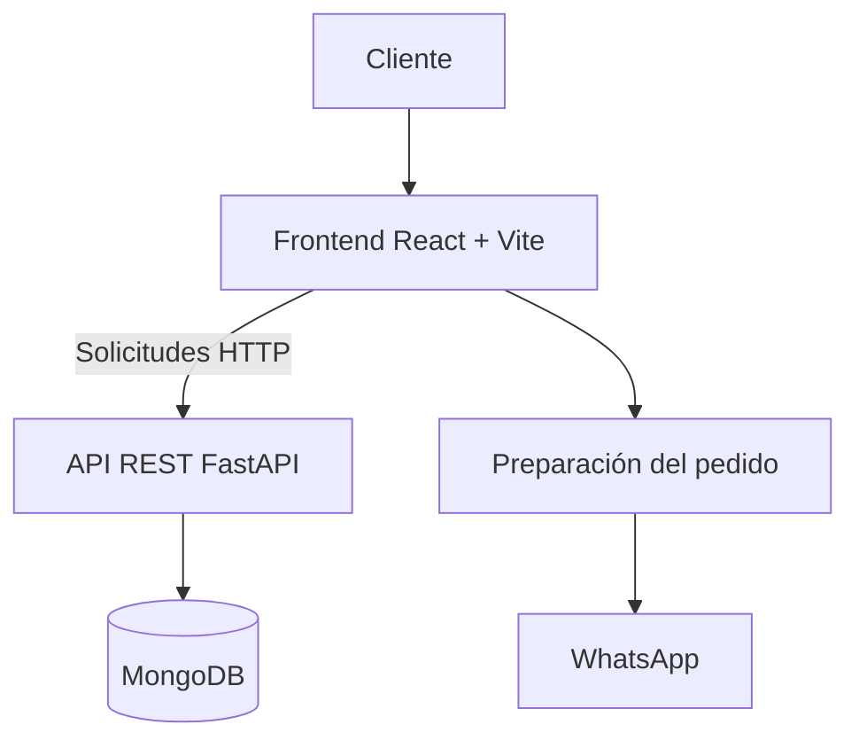

<div align="center">

# 🍣 SETSU

### Tienda de sushi artesanal

**Descubrí el menú, personalizá combinados y prepará tu pedido de forma sencilla.**

<br>


<br>

[Descripción](#-acerca-del-proyecto) ·
[Funcionalidades](#-funcionalidades) ·
[Tecnologías](#-tecnologías) ·
[Instalación](#-puesta-en-marcha) ·
[Documentación](#-documentación)

</div>

---

## 📖 Acerca del proyecto

**Setsu** es una aplicación web diseñada para una tienda de sushi artesanal. Su objetivo es ofrecer una experiencia digital sencilla para explorar el catálogo, descubrir combinados, seleccionar variantes disponibles y preparar pedidos.

La aplicación separa la interfaz del cliente de la API y la base de datos, lo que permite organizar el desarrollo y el mantenimiento de cada componente.

### Estructura de la aplicación

| Componente | Descripción |
|:--|:--|
| **Frontend** | Interfaz web desarrollada con React y Vite. |
| **Backend** | API REST desarrollada con Python y FastAPI. |
| **Base de datos** | MongoDB para almacenar la información del catálogo. |
| **Pedidos** | Preparación de un resumen para coordinar el pedido mediante WhatsApp. |

> **Alcance actual:** el flujo de pedidos prepara un mensaje para WhatsApp. No registra el pedido en MongoDB ni procesa pagos en línea mediante ese flujo.

---

## ✨ Funcionalidades

| Funcionalidad | Descripción |
|:--|:--|
| 🍣 **Piezas individuales** | Consulta de las piezas de sushi disponibles. |
| 🍱 **Combinados** | Exploración de combinados y sus variantes. |
| 🥢 **Personalización** | Selección de las opciones disponibles para los productos. |
| 🥤 **Bebidas y extras** | Consulta de productos complementarios. |
| 🛒 **Carrito** | Organización de productos, cantidades y total estimado. |
| 💬 **WhatsApp** | Preparación del resumen del pedido para coordinarlo con el comercio. |
| 🔌 **API REST** | Comunicación entre el frontend y el backend. |
| 🗄️ **Persistencia** | Almacenamiento de los productos del catálogo en MongoDB. |

---

## 🧱 Arquitectura

La aplicación se organiza en una arquitectura cliente-servidor.



### Flujo general

1. El cliente accede a la aplicación web.
2. El frontend consulta el catálogo mediante la API REST.
3. El backend procesa las solicitudes y accede a MongoDB.
4. La información de los productos se presenta en la interfaz.
5. El cliente selecciona los productos y prepara su pedido.
6. La aplicación genera el mensaje que permite coordinar el pedido mediante WhatsApp.

---

## 🛠️ Tecnologías

<div align="center">


</div>

| Capa | Tecnologías |
|:--|:--|
| **Frontend** | React, Vite, React Router, Redux Toolkit, Axios |
| **Interfaz** | styled-components, Framer Motion, React Icons |
| **Backend** | Python, FastAPI, Pydantic, Uvicorn |
| **Base de datos** | MongoDB |
| **Herramientas** | Git, npm, Docker |

---

## 📂 Estructura general

```text
Setsu/
├── Frontend/
│   ├── README.md
│   ├── package.json
│   ├── public/
│   └── src/
│       ├── components/
│       ├── hooks/
│       ├── pages/
│       ├── routes/
│       ├── store/
│       └── Styles/
│
├── Backend/
│   ├── README.md
│   ├── main.py
│   ├── requirements.txt
│   ├── Dockerfile
│   ├── dataBase/
│   ├── models/
│   ├── routes/
│   ├── services/
│   └── scripts/
│
└── README.md
```

> La estructura es orientativa. Los nombres y directorios deben coincidir con los existentes en tu repositorio.

---

## 🚀 Puesta en marcha

Para ejecutar Setsu localmente, necesitás configurar el frontend, el backend y una instancia de MongoDB.

### Requisitos previos

- Node.js y npm.
- Python y pip.
- MongoDB local o MongoDB Atlas.
- Git.

### 1. Configurar el backend

Ingresá a la carpeta `Backend/` y seguí las instrucciones de su documentación.

[**Consultar instalación y configuración del Backend →**](Backend/README.md)

### 2. Configurar el frontend

Ingresá a la carpeta `Frontend/` e instalá las dependencias del proyecto.

[**Consultar instalación y configuración del Frontend →**](Frontend/README.md)

### 3. Configurar las variables de entorno

El frontend utiliza la variable:

```env
VITE_API_URL=http://localhost:8000
```

El backend utiliza variables para configurar la conexión a MongoDB y los orígenes permitidos, entre otras opciones:

```env
MONGO_URL=mongodb://localhost:27017
DB_NAME=SETSUNAI
ALLOWED_ORIGINS=http://localhost:5173
```

Los valores son ejemplos para desarrollo local. Ajustalos a tu configuración real.

**Importante:** no publiques contraseñas, tokens ni cadenas de conexión privadas en el repositorio.

---

## 📚 Documentación

Cada componente tiene su propio README para facilitar la instalación, el desarrollo y el mantenimiento.

<div align="center">

| Documento | Contenido |
|:--|:--|
| [Frontend](Frontend/README.md) | Interfaz, componentes, rutas, configuración y despliegue. |
| [Backend](Backend/README.md) | API REST, endpoints, modelos, MongoDB y configuración. |

</div>

### Documentación interactiva de la API

Cuando el backend está en ejecución local, podés consultar Swagger UI:

**http://localhost:8000/docs**

La disponibilidad de esta dirección depende de la configuración del servidor.

---

## 🔐 Consideraciones de seguridad

- Configurá CORS para permitir únicamente los orígenes necesarios.
- No incluyas credenciales privadas en el código fuente.
- Mantené los archivos `.env` fuera del control de versiones.
- Validá los datos y las reglas de negocio en el backend.
- Revisá los permisos de acceso a MongoDB.
- Protegé los endpoints de escritura antes de exponerlos públicamente.
- Mantené actualizadas las dependencias del proyecto.

---

<div align="center">

### 🍣 SETSU

**Sushi artesanal, experiencia digital.**

<sub>Frontend React · API FastAPI · MongoDB</sub>

</div>